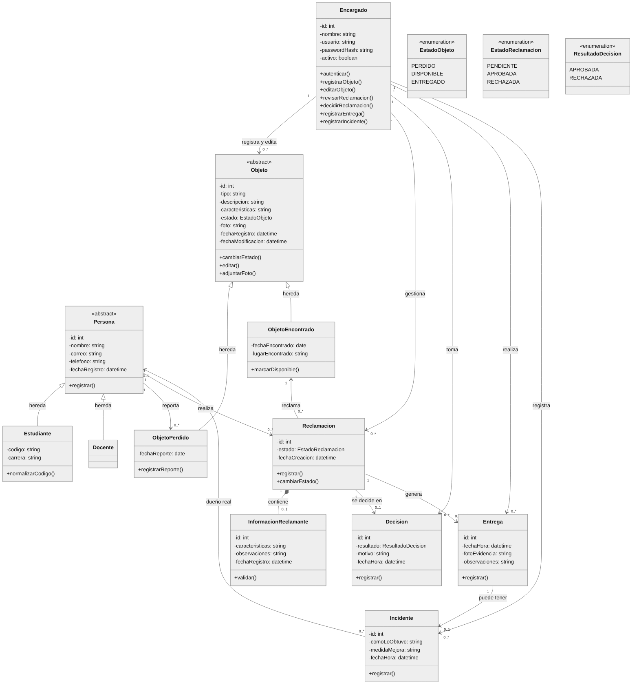
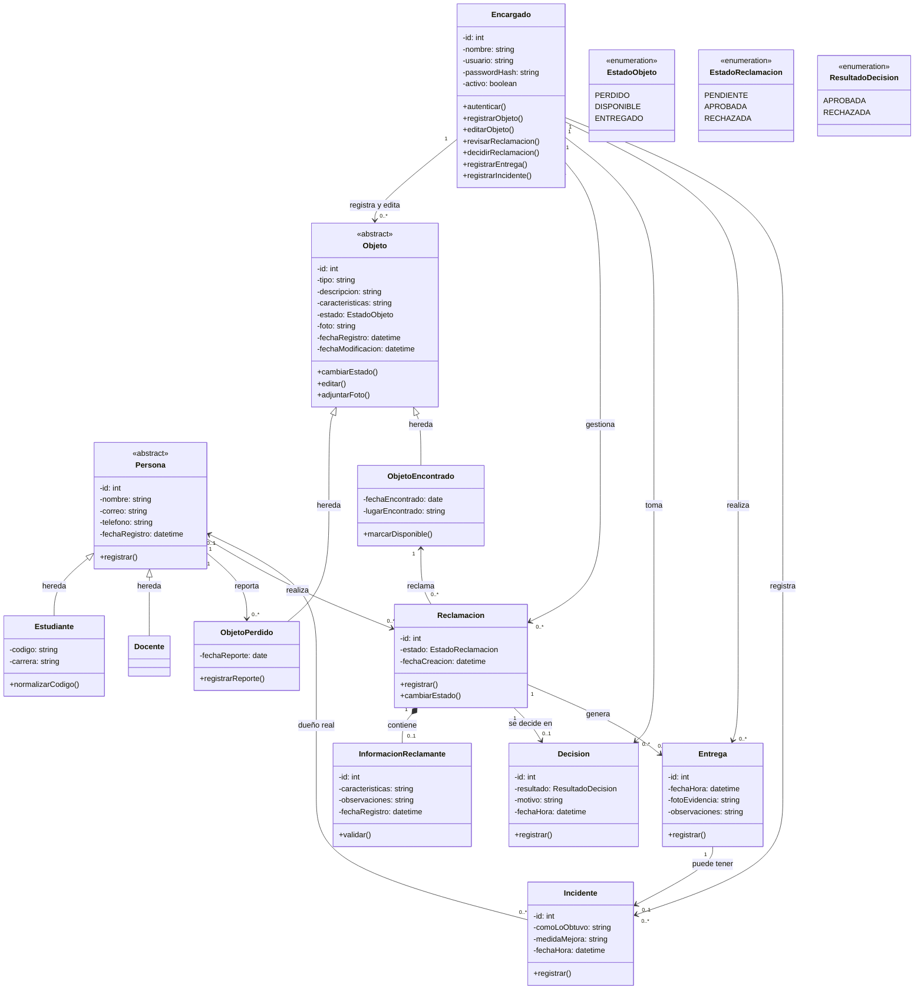

# Diagrama de clases — L&F

Versión actualizada del diagrama de clases (Figura 2 del documento de modelado UML). Incorpora el ajuste de alcance RF19–RF25 de la Fase 3 y coincide con la implementación en [`backend/app/models.py`](../../backend/app/models.py).

*Imagen para el documento del Proyecto de Aula: [`diagrama-clases.png`](diagrama-clases.png) (también en [`diagrama-clases.svg`](diagrama-clases.svg), que no pierde calidad al ampliarla).*

## Cambios respecto a la versión corregida

| Elemento | Antes | Ahora | Motivo |
|---|---|---|---|
| `Estudiante` | Clase independiente con `identificacion` y `contacto` | Hereda de `Persona`; tiene `codigo` y `carrera` | Los docentes también pierden y reclaman objetos (RF19). `codigo` es el nombre que se usa en la universidad |
| `Persona` | No existía | Clase abstracta con `nombre`, `correo`, `telefono` | Reúne lo que tienen en común estudiantes y docentes; `contacto` se separó en `correo` y `telefono` |
| `Docente` | No existía | Hereda de `Persona`, sin atributos propios | RF19: el docente solo tiene nombre, correo institucional y teléfono |
| `Encargado` | Sin contraseña | Agrega `passwordHash` y los métodos `editarObjeto()`, `registrarEntrega()`, `registrarIncidente()` | RF01 (inicio de sesión), RF25 y RF23 |
| `Objeto` | Sin foto ni edición | Agrega `foto`, `fechaRegistro`, `fechaModificacion`, `editar()` y `adjuntarFoto()` | RF20 (foto) y RF25 (edición con trazabilidad) |
| `Objeto` → `Encargado` | No estaba | "registra y edita" | Trazabilidad de quién registró y quién editó el objeto |
| `ObjetoPerdido` → `Persona` | "reporta" desde `Estudiante` | "reporta" desde `Persona` | Un docente también puede reportar una pérdida |
| `Reclamacion` | La realiza un `Estudiante` | La realiza una `Persona` | RF19 |
| `Entrega` | Sin foto ni encargado | Agrega `fotoEvidencia` y la relación "realiza" con `Encargado` | RF22 (foto de la persona con el objeto) y trazabilidad de quién entregó |
| `Incidente` | No existía | Clase nueva, unida a `Entrega`, a `Persona` (dueño real) y a `Encargado` | RF23: registrar entregas fraudulentas, cómo ocurrieron y qué mejorar |
| Enumeraciones | Se nombraban como tipos | Se muestran `EstadoObjeto`, `EstadoReclamacion` y `ResultadoDecision` con sus valores | Deja explícitos los estados del flujo |

## Cómo leer el diagrama

- **Herencia (triángulo vacío):** `Estudiante` y `Docente` son tipos de `Persona`; `ObjetoPerdido` y `ObjetoEncontrado` son tipos de `Objeto`. Las clases abstractas no se crean directamente: siempre se registra un estudiante o un docente, y un objeto perdido o uno encontrado.
- **Composición (rombo relleno):** la `InformacionReclamante` pertenece a una `Reclamacion` y no existe sin ella.
- **Asociación (flecha):** indica qué clase conoce a cuál. Los números son la multiplicidad: `1` es exactamente uno, `0..1` es uno o ninguno, `0..*` es cualquier cantidad.
- **La alerta del RF24** (3 reclamaciones rechazadas de objetos distintos) no es una clase: se calcula con las `Reclamacion` en estado `RECHAZADA` de cada `Persona`.

## Relación con la base de datos

El diagrama de clases representa el dominio, no las tablas. Por eso hay dos diferencias con el [modelo de datos](../modelo-datos.md):

- `Persona`, `Estudiante` y `Docente` se guardan en una sola tabla `persona`, con una columna `tipo`.
- `Objeto`, `ObjetoPerdido` y `ObjetoEncontrado` se guardan en una sola tabla `objeto`, con una columna `tipo_registro`.

Esta forma de guardar una herencia en una sola tabla se llama *herencia de tabla única*. Se eligió porque permite consultar a todas las personas, o todos los objetos, con una sola consulta.

## Código fuente del diagrama

GitHub dibuja este bloque automáticamente. Para modificar el diagrama, edita el bloque y vuelve a generar la imagen en [mermaid.live](https://mermaid.live) (pega el código y descarga el PNG o el SVG).

