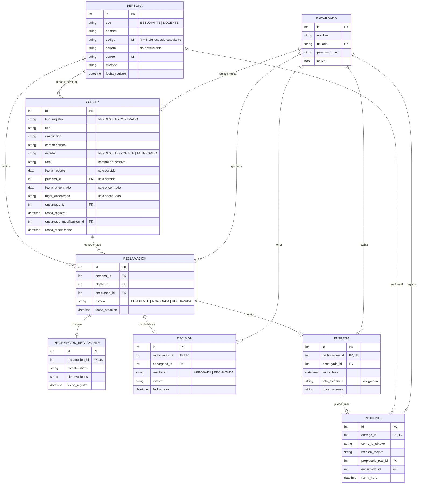

# Modelo de datos — L&F

Diseño de la base de datos SQLite del sistema. Se implementa con SQLAlchemy en [`backend/app/models.py`](../backend/app/models.py) y parte del diagrama de clases corregido ([`docs/diagramas/`](diagramas/)), con los ajustes de alcance RF19–RF26 de la Fase 3.

## Diagrama entidad-relación



## Tablas y requerimientos

| Tabla | Propósito | Requerimientos |
|---|---|---|
| `encargado` | Único usuario del sistema; responsable de cada acción | RF01, RF13 |
| `persona` | Estudiante o docente que reporta una pérdida o reclama un objeto | RF02, RF19 |
| `objeto` | Objetos perdidos y encontrados en una sola tabla, con foto y registro de edición | RF03, RF04, RF05, RF16, RF20, RF25 |
| `reclamacion` | Une a una persona con un objeto encontrado | RF06, RF08 |
| `informacion_reclamante` | Lo que la persona describe para probar que el objeto es suyo | RF07, RF09, RF21 |
| `decision` | Aprobación o rechazo con motivo, encargado y fecha/hora | RF10–RF14, RF17, RF24 |
| `entrega` | Devolución del objeto, encargado que la hizo y foto de evidencia | RF15, RF18, RF22 |
| `incidente` | Entrega que resultó fraudulenta: cómo ocurrió y qué mejorar | RF23 |

## Estados

- **Objeto:** `PERDIDO` (reporte de pérdida) · `DISPONIBLE` (encontrado, se puede reclamar) → `ENTREGADO` (entregado a quien lo reclamó). Si después se descubre un fraude, sigue `ENTREGADO` y se registra un incidente.
- **Reclamación:** `PENDIENTE` → `APROBADA` o `RECHAZADA`.

## Datos de cada persona

| Dato | Estudiante | Docente |
|---|---|---|
| Nombre | Obligatorio | Obligatorio |
| Código (`T00000000`) | Obligatorio, único | No aplica |
| Carrera | Obligatorio | No aplica |
| Correo institucional | Obligatorio, único | Obligatorio, único (lo identifica) |
| Teléfono | Obligatorio | Obligatorio |

## Decisiones de diseño

1. **Una sola tabla para objetos perdidos y encontrados.** En el diagrama de clases, `ObjetoPerdido` y `ObjetoEncontrado` heredan de `Objeto`. Se guardan juntos y se distinguen con `tipo_registro`, porque el RF05 los consulta en conjunto.
2. **Estudiantes y docentes en una sola tabla `persona`.** Los dos pueden perder y reclamar objetos. Con una sola tabla, una reclamación siempre apunta a una persona, sin importar su tipo. Las restricciones `CHECK` garantizan que el estudiante tenga código y carrera y que el docente no los tenga.
3. **El código estudiantil se normaliza.** El backend acepta `t70496`, `70496` o `T00070496` y siempre guarda `T00070496`. La base además rechaza cualquier código que no tenga el formato `T` + 8 dígitos. No se puede comprobar que el código pertenezca a un estudiante matriculado, porque eso exigiría conectarse a los sistemas de la universidad (fuera del alcance).
4. **Las fotos se guardan como archivos, no dentro de la base.** La base solo guarda el nombre del archivo, que es aleatorio. Las fotos no son públicas: solo se ven a través de endpoints que exigen sesión.
5. **El encargado guarda `password_hash`.** Es necesario para el RF01. Se almacena el hash bcrypt, nunca la contraseña.
6. **La decisión es una tabla aparte.** La reclamación cambia de estado; la decisión es un registro histórico que conserva quién decidió, qué, por qué y cuándo (RNF-05).
7. **La alerta de intentos fallidos (RF24) no necesita tabla.** Se calcula contando las reclamaciones `RECHAZADA` de cada persona sobre objetos distintos. No cuenta un objeto si un incidente reconoce a esa persona como su dueño real: ese rechazo no fue un intento falso.
8. **El fraude se registra sin cambiar el estado del objeto.** El objeto ya salió de la oficina; el incidente deja la evidencia y la lección aprendida.
9. **Edición con trazabilidad (RF25).** Se guarda quién hizo la última edición y cuándo. Un objeto `ENTREGADO` no se puede editar, y el estado nunca se edita a mano.
10. **Reclamaciones presenciales.** La persona reclama en el mostrador y el encargado decide en el momento. Un objeto puede acumular varias reclamaciones rechazadas, pero solo una aprobada.
11. **Detección de posibles fraudes (RF26) sin tablas nuevas.** La entrega previa de un objeto se arma con la entrega, la reclamación aprobada, su descripción y su decisión, que ya existen.

## Dónde se aplica cada regla

| Regla | Dónde se garantiza |
|---|---|
| Campos obligatorios (RNF-04) | Base de datos (`NOT NULL`) y esquemas de la API |
| Reclamación con persona y objeto existentes (RNF-03) | Base de datos: llaves foráneas (activadas con `PRAGMA foreign_keys = ON`) |
| Código, correo y usuario no se repiten | Base de datos: `UNIQUE`; la API responde 409 con un mensaje claro |
| Formato del código `T` + 8 dígitos | Base de datos (`CHECK ... GLOB`) y normalización en la API |
| Estudiante con código y carrera; docente sin ellos | Base de datos: `CHECK` |
| Motivo obligatorio, sin texto vacío (RF12) | Base de datos: `CHECK (length(trim(motivo)) > 0)` |
| Una reclamación se decide y se entrega una sola vez | Base de datos: `UNIQUE` en `reclamacion_id` de `decision` y `entrega` |
| Un objeto no puede tener dos reclamaciones aprobadas | Base de datos: índice único parcial en `reclamacion(objeto_id)` donde `estado = 'APROBADA'` |
| Un objeto perdido tiene persona; el estado concuerda con el tipo | Base de datos: `CHECK` en `objeto` |
| Toda entrega tiene foto de evidencia (RF22) | Base de datos: `foto_evidencia NOT NULL` |
| El incidente explica cómo ocurrió y qué mejorar (RF23) | Base de datos: `CHECK` de texto no vacío |
| Las fotos son imágenes reales (JPG, PNG, WEBP) de máximo 5 MB | API: se revisan los primeros bytes del archivo |
| Un objeto `ENTREGADO` no se edita ni cambia de foto (RF25) | API |
| Solo se reclaman objetos `ENCONTRADO`; no se reclama uno con reclamación aprobada que aún no se entrega (HCU06) | API |
| Un objeto ya `ENTREGADO` se puede reclamar para comparar, pero no se puede aprobar (RF26) | API |
| La descripción del reclamante se registra una sola vez y no se modifica (RF07) | API |
| La comparación (con foto y características) solo se muestra después de la descripción (RF21) | API |
| No se decide sin descripción del reclamante (HCU08, HCU09) | API |
| Solo se decide sobre reclamaciones `PENDIENTE` | API |
| Solo se entrega con decisión `APROBADA`; la entrega y el cambio a `ENTREGADO` se guardan juntos en una transacción (RF15, RF16) | API |
| El dueño real de un incidente existe y no es quien se llevó el objeto (RF23) | API |

## Crear y verificar la base

Desde `backend/`, con el entorno virtual activo y el archivo `.env` configurado:

```bash
python seed.py          # crea las tablas, borra las fotos anteriores y carga datos de prueba
python verificar_bd.py  # comprueba relaciones y que se rechacen datos inválidos
```

**Datos de prueba:** 1 encargado, 4 estudiantes, 1 docente, 8 objetos (incluye un reporte de pérdida del docente que coincide con una sombrilla ya entregada) y 7 reclamaciones: una pendiente, dos aprobadas y entregadas (una de ellas con incidente de fraude) y cuatro rechazadas (tres de la misma persona, para la alerta del RF24). Son inventados: no corresponden a personas reales ni a la base de datos de la universidad.

## Diagrama de clases

El diagrama de clases actualizado con estos cambios está en [`docs/diagramas/diagrama-clases.md`](diagramas/diagrama-clases.md).

## Pendiente para la Fase 7

Agregar los RF19–RF26 al documento del Proyecto de Aula, en la sección de requerimientos y en la tabla de validación y ajuste del alcance, y reemplazar la Figura 2 por el diagrama de clases actualizado.
